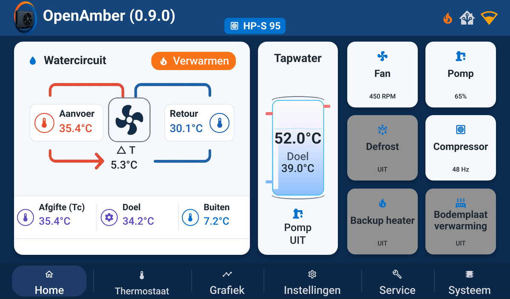
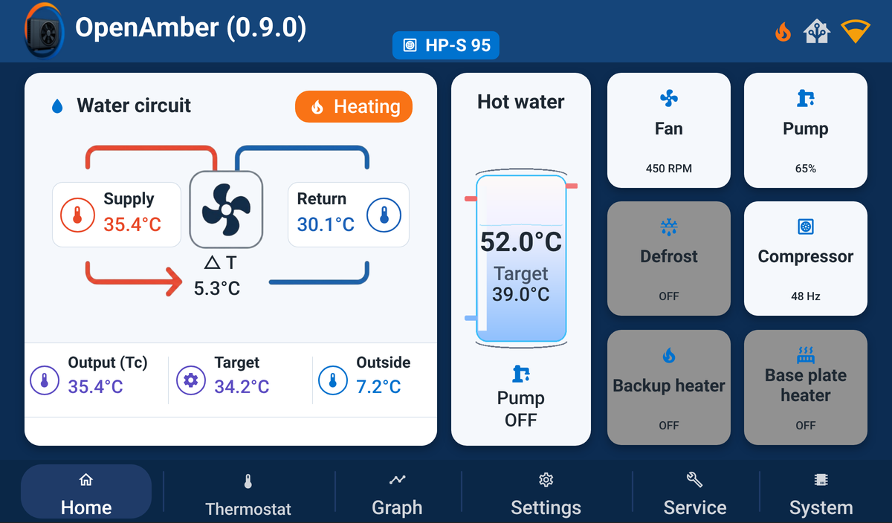
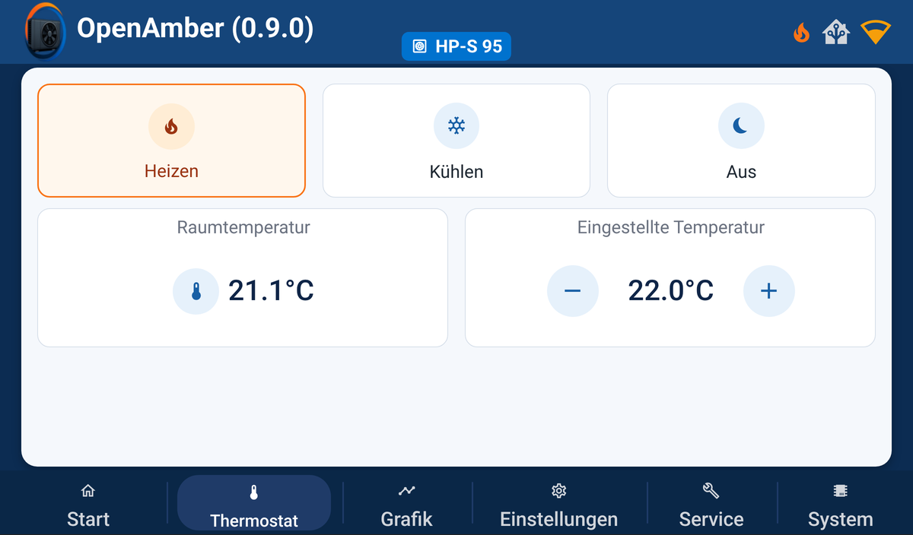
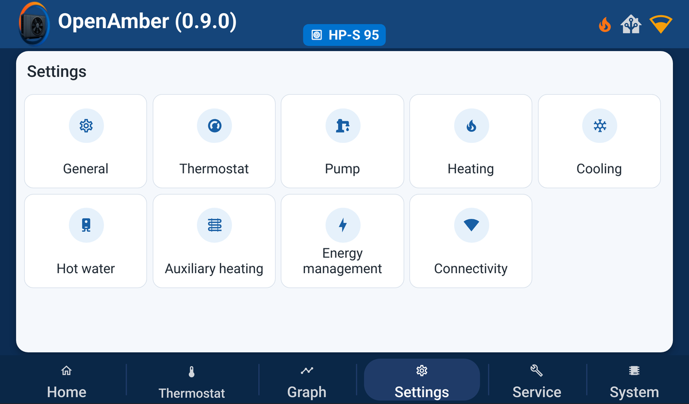
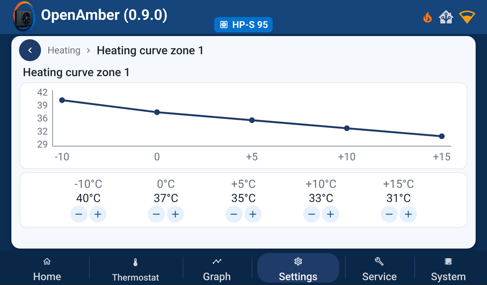
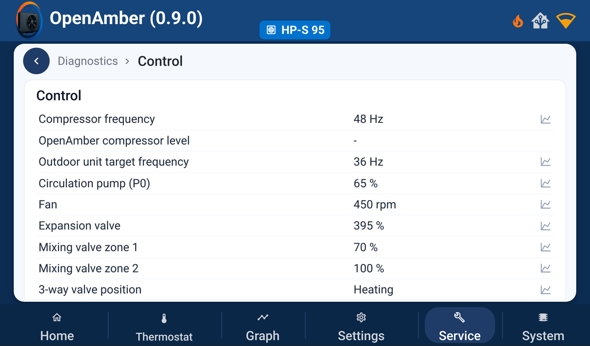
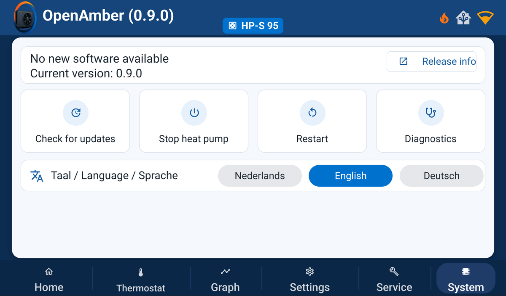

# OpenAmber Display Card

**Unofficial** Home Assistant card that looks and works like the Waveshare touch display of
[OpenAmber](https://github.com/Jordi1990/openamber). This is a community project and is not
maintained by the OpenAmber developer.

*Nederlands: een onofficiële Home Assistant-kaart die eruitziet en werkt als het Waveshare-display van OpenAmber.*

## Screenshots

All pages of the display, here with example values. Languages switch on the Systeem page.

| Nederlands | English | Deutsch |
|---|---|---|
|  |  |  |

| Thermostat | Settings |
|---|---|
|  |  |
| **Heating curve** | **Diagnostics (tap a value for its history)** |
|  |  |
| **System with language switch** | |
|  | |

## Quick start (v0.3)

The easiest way: a dashboard that builds itself. It contains every page of the display and finds
your OpenAmber entities automatically, whatever you named the device.

1. Install [button-card](https://github.com/custom-cards/button-card) (7.x) from HACS / the Marketplace.
2. Install this repository (HACS custom repository, type *Dashboard*, see below) or copy
   `dist/openamber-display-card.js` to `/config/www/` and add it as resource
   `/local/openamber-display-card.js` (*JavaScript module*).
3. Optional, for the language switch on the Systeem page: create a dropdown helper
   `OpenAmber display taal` with the options `Nederlands`, `English`, `Deutsch`
   (entity `input_select.openamber_display_taal`).
4. Create a new dashboard (e.g. URL `openamber-display`), open *Edit > Raw configuration editor*
   and replace everything with:

```yaml
strategy:
  type: custom:openamber-display
  # optional:
  # language: English          # used when the language helper does not exist
  # device_id: 623fce465f...   # only with more than one OpenAmber
```

5. Reload the browser (Ctrl+Shift+R).

The dashboard is generated each time it is opened, so it is not edited in the UI. Looking up the
entities needs an administrator account; other users fall back to matching entity names.

## The card (v0.4): the display inside your own dashboard

Want the display as one card in an existing dashboard? Steps 1–3 as above, then add a card:

```yaml
type: custom:openamber-display-card
# optional:
# page: home          # start page, e.g. thermostaat, grafiek, instellingen, service, systeem
# language: Deutsch   # used when the language helper does not exist
# device_id: 623fce465f...
```

All pages work inside the card: the navigation bar and the tiles switch pages within the card
and do not change the dashboard URL. Works best full width (Panel view, or a full-width card in a
Sections view).

## Static dashboard (YAML)

If you prefer a dashboard you can edit yourself, the same dashboard is available as YAML in
[`dashboard/`](dashboard/). It has every page of the display: Home, Thermostaat, Grafiek,
Instellingen (all firmware menus), Service (incl. Diagnose with history graphs, Foutmeldingen,
Waarschuwingen) and Systeem.

**Languages:** Nederlands (default), English and Deutsch, switchable on the Systeem page.

### Installation

1. Install [button-card](https://github.com/custom-cards/button-card) (7.x) from HACS / the Marketplace.
2. Copy `dashboard/oa-graph.js` to `/config/www/` and add it as a dashboard resource:
   `/local/oa-graph.js`, type *JavaScript module*.
3. Create a dropdown helper (Settings > Devices & services > Helpers > Dropdown) named
   `OpenAmber display taal` with the options `Nederlands`, `English`, `Deutsch`
   → entity `input_select.openamber_display_taal`.
4. Create a new dashboard, open *Edit > Raw configuration editor* and paste the content of
   `dashboard/openamber-display.yaml`.
5. Reload the browser (Ctrl+Shift+R).

### Entity IDs

The dashboard uses fixed entity IDs from the author's installation. Most are `*.openamber_*`,
some are `*.zentrale_openamber_*` (the device was renamed to "Zentrale OpenAmber"). If your IDs
differ, use search & replace in the YAML before pasting. Values that do not exist show `-`.
The strategy above does this automatically.

### Translations

The dictionaries are in `dashboard/i18n/` (`strings`: exact texts, `patterns`: texts with numbers).
Selects keep sending the Dutch option values to the firmware, so switching the language never
changes a setting.

## Installing the file

### HACS / Home Assistant Marketplace (custom repository)

1. Add `https://github.com/Spirituso/openamber-display-card` as a custom repository, type *Dashboard*.
2. Install **OpenAmber Display Card**.
3. Reload the browser (Ctrl+Shift+R).

### Manual

Copy `dist/openamber-display-card.js` to `/config/www/` and add it as a dashboard resource
(`/local/openamber-display-card.js`, type *JavaScript module*).

## Firmware versions

The pages are generated from `dashboard/openamber-display.yaml`. Entities are looked up by the
names set in the OpenAmber firmware (`src/entities.js`, generated from the firmware). After a
firmware update that renames entities:

```sh
python3 tools/gen_entities.py /path/to/openamber > src/entities.js
python3 tools/gen_dashboard.py > src/dashboard.js
npm run build
```

Entities that your firmware does not expose are shown as `-`, like on the display.

## Roadmap

1. Discovery of the OpenAmber entities — done
2. All display pages with automatic entity lookup (dashboard strategy) — done (v0.3)
3. Languages: Dutch, English, German — done
4. A single card (`custom:openamber-display-card`) for use inside other dashboards — done (v0.4)

## License

GPL-3.0, like OpenAmber. Layout, texts and images are derived from the OpenAmber firmware
(© the OpenAmber contributors).
